# Pure Insights Command Center

**Operational admin dashboard for the Pure Insights analytics portal**, Pure Storage candidate
assessment, Case Study 3.

After the move from Tableau Server to a custom portal (React, Node.js, Snowflake, AWS), the business
lost its admin view: nobody could see which reports are slow or failing, who owns them, or what they
cost. This project rebuilds that view:

- a **React + Node.js/Express** dashboard with **role-based access control** enforced on the server,
- **real-time WebSocket alerts** when load time exceeds 15 s or a refresh fails, designed to avoid alert storms,
- a **Snowflake SQL suite** that attributes credits and AWS cost to each report and computes the cost per active view,
- a **data-quality layer** that detects, flags, counts and documents every anomaly in the data, without dropping a single row.

| | |
|---|---|
| Data | 2,000 snapshots · 100 reports · **0 rows dropped** · 20 checks, 14 with findings |
| Cost | **$4.08M** attributed (Snowflake $3.62M + AWS $0.46M) · **$2.71 per active view** |
| Waste | **25 reports** in the top cost-per-view quartile ($1.12M) · **14 orphaned reports** ($587K with no owner) |
| Alerts | 2,154 "one per bad row" alerts → **860 actionable notifications (−60%)**, nothing hidden |
| Tests | **187 automated tests**; SQL and JavaScript cross-checked number by number |

---

## Quick start

**Prerequisites:** [Node.js](https://nodejs.org) **20.19 or newer** (22 LTS recommended) and Git.

```bash
git clone https://github.com/VaibhavVishal1807/Technical-Data-AI-Validation-Monetization.git
cd Technical-Data-AI-Validation-Monetization
npm run install:all
npm run dev
```

Then open **http://localhost:5173** and sign in with one of the accounts below.

- `npm run install:all` installs the root tool (`concurrently`), the backend and the frontend.
- `npm run dev` starts the API on port 4000 and the React app on port 5173 together. Press Ctrl+C to stop both.
- No `.env` is needed. Every setting has a default (see [Configuration](#configuration)).
- Single-server mode: `npm start` builds the React app and serves everything from **http://127.0.0.1:4000**.

### Sign-in accounts

| Username | Password | Role | Can see |
|---|---|---|---|
| `admin` | `admin123` | admin | Everything, including costs, replay control and users |
| `analyst` | `analyst123` | analyst | Overview, Live Alerts, Reports, Orphaned, Costs, Data Quality (read-only) |
| `viewer` | `viewer123` | viewer | Overview (no cost figures), Live Alerts, Data Quality |

The login page does not list these accounts; they are documented here, and in development the API
prints the usernames when it starts. Passwords are stored only as bcrypt hashes (`backend/src/users.js`).
Built-in accounts suit an evaluation; production would sign people in through the company's identity
provider (SSO).

### Things to try
1. Sign in as **admin**. Alerts start streaming at once (the telemetry replay plays the CSV as live data); CRITICAL ones pop up.
2. **Live Alerts**: pause, change the speed, reset. The "Open right now" table always matches the reports currently in breach.
3. **Costs**: monthly cost chart, then sort the table by cost per view and tick *Waste only*.
4. **Reports → RPT_232**: 20-month load-time chart against the 15 s and 30 s thresholds, and every raw row with its flags.
5. **Data Quality**: every anomaly with count, detection rule, handling and rationale.
6. Sign out and in as **viewer**: fewer menu items, the cost tile is hidden, and http://localhost:5173/costs says "No access".
   The API refuses too:
   ```bash
   curl -i http://127.0.0.1:4000/api/costs/allocation      # 401: no token
   ```

---

## How the brief is covered

| Brief | Implementation |
|---|---|
| **1. Full-stack web app with RBAC** to monitor system health and orphaned reports | React (Vite) + Express. JWT login, 3 roles, 7 permissions, checked on **every API route** (`backend/src/app.js` is the access map), field-level control (viewers get health without cost). Pages: Overview, Live Alerts, Reports + detail, Orphaned, Costs, Data Quality, Users |
| **2. Real-time telemetry and WebSocket alerting** when load time > 15 s or refresh fails | A replay service streams the 2,000 snapshots as live telemetry. A state-machine alert engine (state changes, severity, escalation, recovery, per-report cooldown) feeds an authenticated WebSocket `/ws/alerts` |
| **3. Cloud cost allocation engine**: SQL on simulated Snowflake `ACCOUNT_USAGE`, credits per report, unit cost per active view | `sql/01–04`: simulated `QUERY_ATTRIBUTION_HISTORY` (by `QUERY_TAG`) + portal + AWS sources, attribution with negative credits excluded and `NULLIF` for zero views, waste quartile, plus a production version on the real `ACCOUNT_USAGE` views. Executed on DuckDB in tests |
| **Injected anomalies** (orphaned owners, negative credits, latency spikes, users vs AWS cost) | Detected, flagged, counted and documented, plus 7 more issues found while profiling. See [docs/DATA_QUALITY.md](docs/DATA_QUALITY.md) |

| Deliverable | Where |
|---|---|
| 1. Runnable full-stack codebase | this repository (`backend/`, `frontend/`) |
| 2. REST API and WebSocket specification | [docs/API_SPEC.md](docs/API_SPEC.md) |
| 3. Snowflake cost allocation SQL suite | [sql/](sql/) (start with [sql/README.md](sql/README.md)) |

---

## Architecture

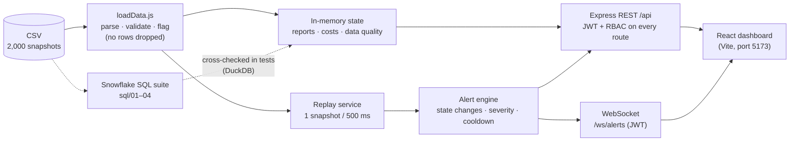

- **Backend** (`backend/`, Node.js + Express 5, CommonJS). At startup the CSV is loaded, cleaned and
  flagged, and costs and data-quality checks are computed **once** and kept in memory (2,000 rows
  need no database). Routes only read that state, so responses are instant.
- **Real-time** (`backend/src/alerts/`, `backend/src/ws.js`). The replay plays snapshots in file order
  (the only time signal in the data). Each goes through the alert engine; notifications are broadcast
  over one WebSocket that shares port 4000 and checks the JWT during the upgrade handshake.
- **Frontend** (`frontend/`, React 19 + Vite). One shared WebSocket feeds the live feed, header badge
  and pop-ups; REST calls load page data. The Vite dev server proxies `/api` and `/ws`, so the browser
  sees one origin and no CORS setup is needed. Charts are dependency-free SVG with a colour-blind-safe palette.
  Navigation is a vertical floating dock (adapted from Aceternity UI: icons grow as the mouse approaches,
  the page name appears beside them; a bottom tab bar on phones). The rest of the UI is built from
  [shadcn/ui](https://ui.shadcn.com) components on Tailwind CSS v4: solid cards, soft status badges,
  Sonner pop-ups and lucide icons. Tables use TanStack Table v9
  (sortable headers, sticky header, pagination). The palette lives as CSS variables in `src/index.css`;
  blue `#2563EB` is used only for links, primary buttons and focus rings (the dock keeps its original
  blue highlight for the current page). Apart from the dock's hover effect, only the login page has motion: animated WebGL fibres (`GhostFibers` from [React Bits](https://reactbits.dev)) behind a
  gently tilting card (Aceternity's comet card, tilt capped at 5°). Both switch off when the OS asks for
  reduced motion.
- **SQL** (`sql/`). The Snowflake deliverable, written in SQL that both Snowflake and DuckDB accept.
  Snowflake-only parts (stage, `COPY INTO`, real `ACCOUNT_USAGE`) are clearly marked.

### Project structure
```
.
├── data/                         Source CSV
├── backend/
│   ├── src/
│   │   ├── server.js             Entry point: HTTP + WebSocket, starts the replay
│   │   ├── app.js                Express app; the RBAC access map
│   │   ├── config.js             Settings from .env with safe defaults
│   │   ├── loadData.js           Parse, validate, flag, synthesise periods, report summaries
│   │   ├── dataQuality.js        Data-quality report (every check documented)
│   │   ├── costs.js              Cost allocation, cost per view, waste flag
│   │   ├── health.js             Overview KPIs
│   │   ├── auth.js · users.js · permissions.js   JWT login, middleware, role table
│   │   ├── ws.js                 WebSocket /ws/alerts
│   │   ├── alerts/engine.js      State-change alert engine with cooldown
│   │   ├── alerts/replay.js      Telemetry replay
│   │   └── routes/               auth, health, reports, costs, data-quality, alerts, replay, users
│   ├── scripts/                  npm run dq (data-quality table) · npm run sql (SQL suite on DuckDB)
│   └── tests/                    Jest + supertest (8 suites, 187 tests)
├── frontend/src/
│   ├── pages/                    Login, Overview, LiveAlerts, Reports, ReportDetail, Orphaned, Costs, DataQuality, Users
│   ├── components/               Layout (top bar, toasts), FloatingDock, DataTable, Charts (SVG), Badges, Common, GhostFibers
│   ├── components/ui/            shadcn/ui components (card, table, badge, sonner, tooltip, comet-card, …)
│   ├── api.js · auth.jsx · alertStream.jsx · format.js
│   └── index.css                 Tailwind + theme: colours, type scale, radius as CSS variables
├── sql/                          01_schema · 02_load_clean · 03_cost_allocation · 04_waste_and_anomalies
└── docs/                         API_SPEC.md · DATA_QUALITY.md · screenshots/
```

---

## Testing

```bash
npm test                 # all backend tests (Jest)
```

| Suite | What it proves |
|---|---|
| `loadData.test.js` | Every cleaning rule on hand-made rows, and **every number in the dataset profile** on the real file |
| `dataQuality.test.js` | Nothing dropped, every check documented, all injected anomalies found |
| `costs.test.js` | Cost maths on a hand-checked example, NULLIF behaviour, waste quartile, real-data invariants |
| `auth.test.js` | Middleware edge cases (expired, forged, `alg: none` tokens) and a **role × endpoint matrix** |
| `api.test.js` | Every endpoint's status codes, filters and shapes |
| `engine.test.js` | The brief's alert examples, escalation, cooldown, delayed release, and "active alerts = reports in breach" over the whole file |
| `ws.test.js` | Real server + real WebSocket client: 401/404 refusals, WELCOME, live alerts, broadcast |
| `sql.test.js` | Runs `sql/01–04` on DuckDB and checks they **agree with the JavaScript engine** on all 2,000 rows, 100 reports and 20 months |

More checks from the `backend` folder: `npm run dq` prints the data-quality table, and `npm run sql`
runs the SQL suite and prints its results. DuckDB is an *optional* dependency: if it cannot install
on a platform, everything else still works and only `sql.test.js` is skipped.

Dependency audit: `npm audit --omit=dev` reports **0 vulnerabilities** in what the app runs. A plain
`npm audit` in `backend/` lists moderate advisories that all come from one upstream issue (`sprintf-js`,
pulled in by Jest's test tooling, with no fix released yet). That code only runs during tests.

The whole setup was verified from a **fresh clone**: `npm run install:all`, `npm test`, `npm run dev`
(REST and WebSocket through the Vite proxy) and `npm start` (single server on port 4000).

---

## Configuration

Optional. Copy `backend/.env.example` to `backend/.env` to change anything:

| Variable | Default | Meaning |
|---|---|---|
| `API_PORT` | 4000 | Backend port (the frontend proxy follows it) |
| `JWT_SECRET` | random per start | Set it to keep logins across restarts |
| `CREDIT_PRICE_USD` | 3 | Assumed $ per Snowflake credit |
| `LATENCY_WARNING_SEC` / `LATENCY_CRITICAL_SEC` | 15 / 30 | Alert thresholds |
| `ALERT_COOLDOWN_SNAPSHOTS` | 3 | Quiet period per report and alert type |
| `REPLAY_INTERVAL_MS` | 500 | Speed of the telemetry replay |
| `REPLAY_LOOP` / `REPLAY_AUTOSTART` | true / true | Replay behaviour |

Full list in [docs/API_SPEC.md §5](docs/API_SPEC.md#5-configuration). `.env` is git-ignored; no secrets are committed.

---

## Screenshots

Captured at 1440 × 900.

| Login | Overview (admin) |
|---|---|
| 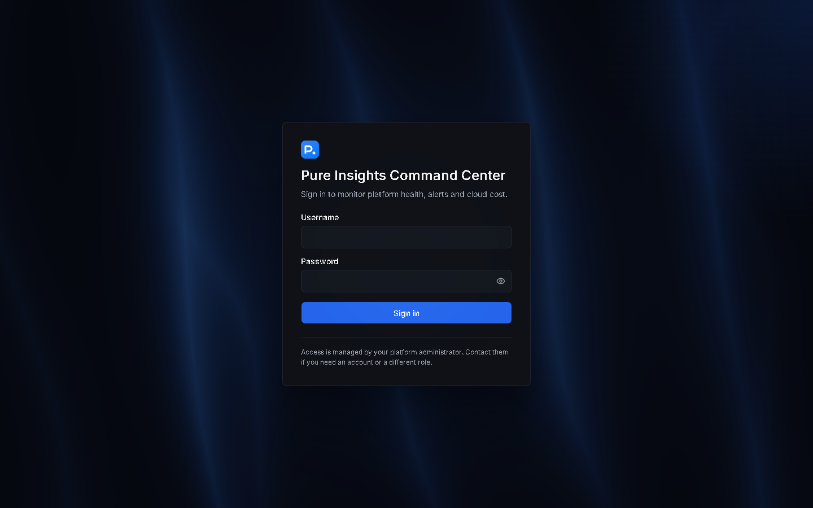 | 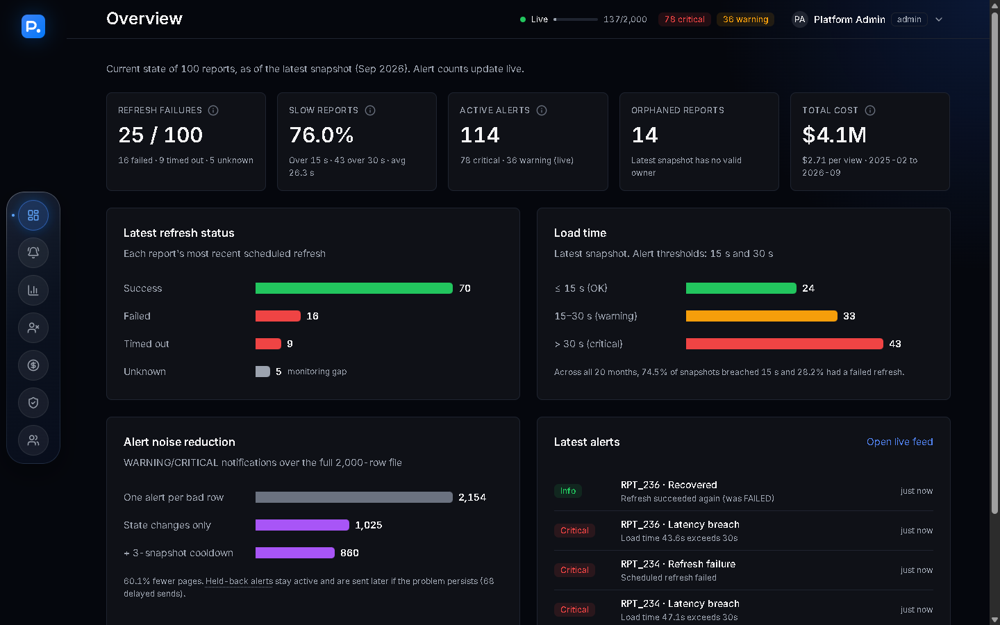 |
| **Live Alerts (with a critical pop-up)** | **Report detail** |
| 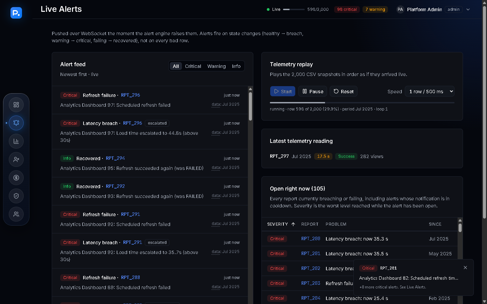 | 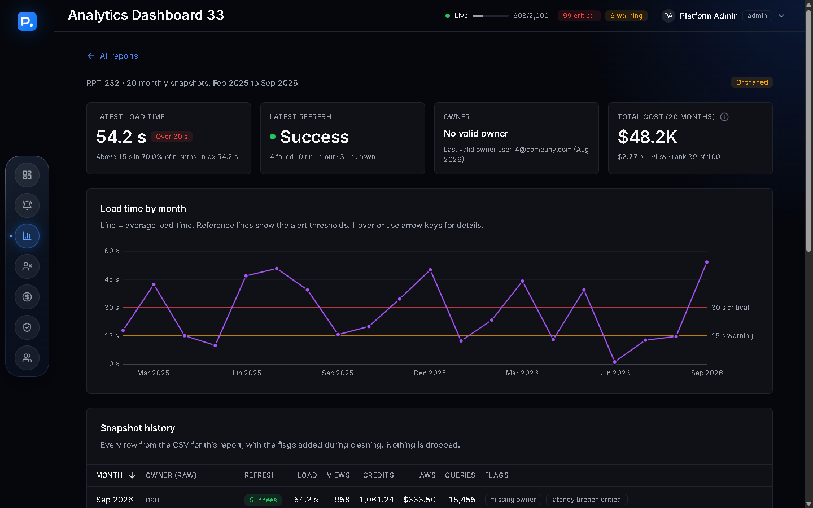 |
| **Costs** | **Data Quality** |
| 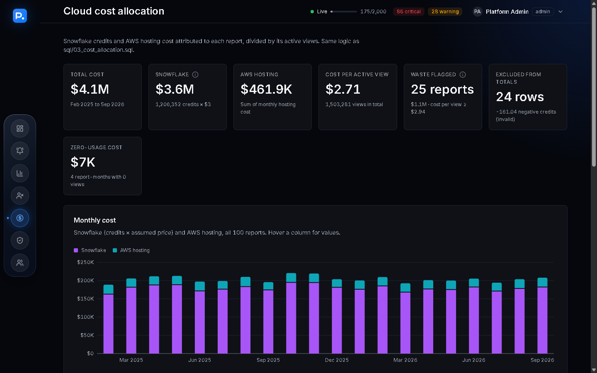 | 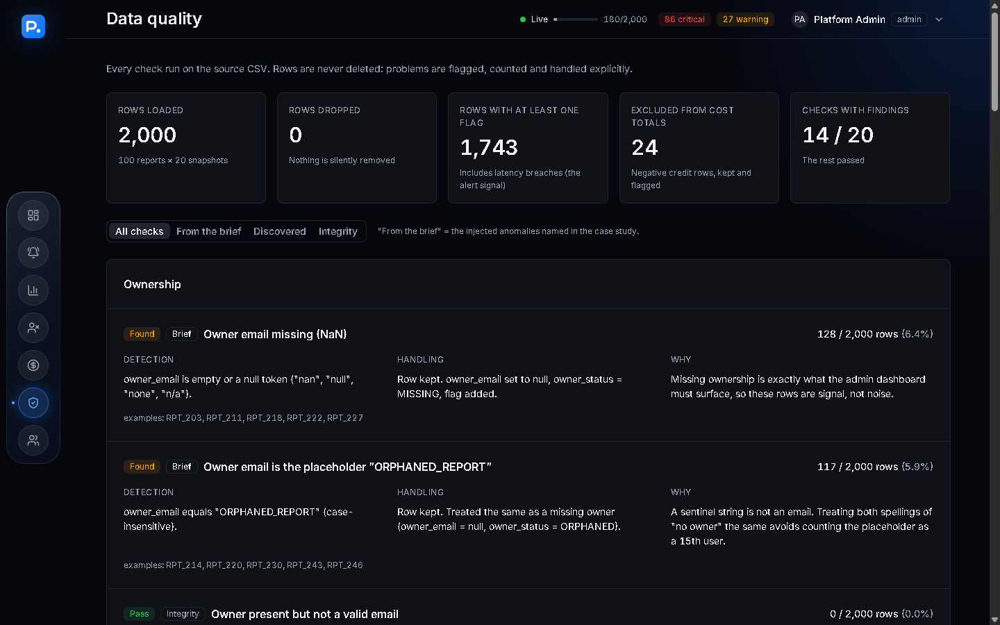 |
| **Reports (search, filters, sortable table)** | **Orphaned reports** |
| 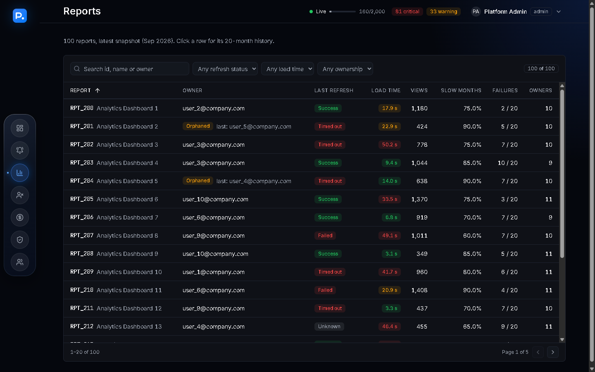 | 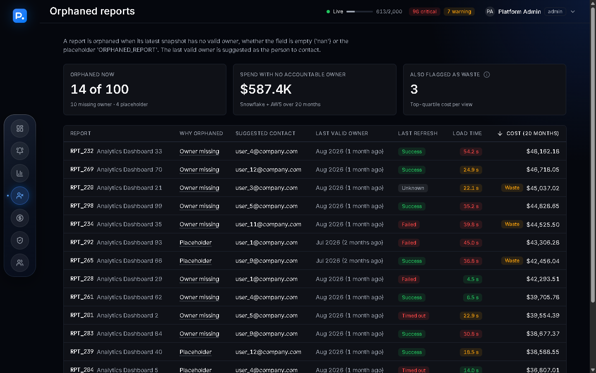 |
| **Users and roles (admin only)** | **Viewer role (cost hidden, fewer pages)** |
| 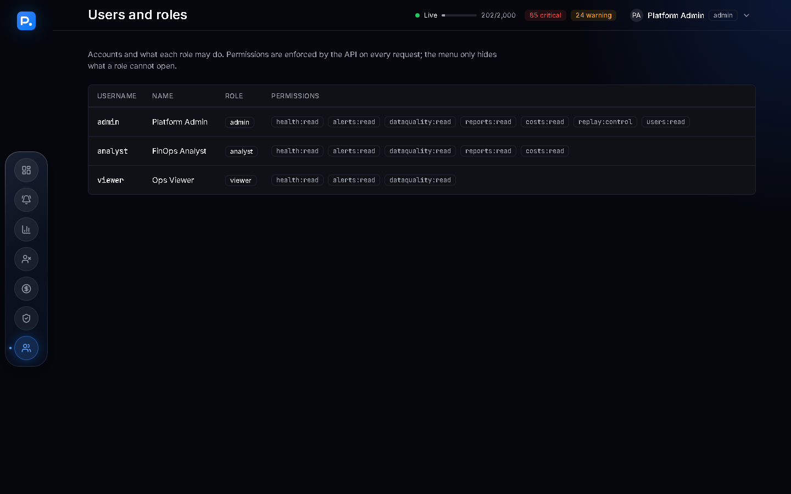 | 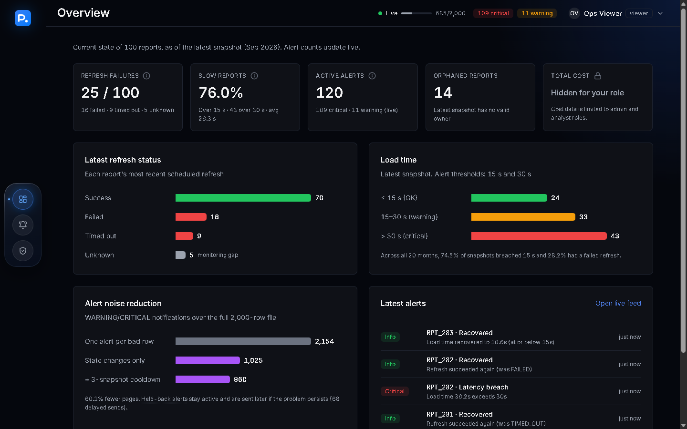 |

---

## Assumptions

Every judgement call about the data or the brief is listed here, so nothing is decided silently.
Details and counts are in [docs/DATA_QUALITY.md](docs/DATA_QUALITY.md).

### Data
1. **File order is chronological.** The CSV has no timestamp. Each report appears 20 times in strict
   round-robin order (RPT_200…RPT_299, then again). The k-th appearance of a report is its k-th snapshot.
2. **One snapshot = one month.** The columns are monthly (`monthly_active_views`,
   `query_count_last_30d`), so each snapshot is mapped to a monthly period. The newest is September 2026
   (setting `LATEST_PERIOD`), so the history runs from 2025-02 to 2026-09. Daily snapshots would make
   the 30-day windows overlap, and adding them up would double count usage and cost.
3. **"No owner" has several spellings.** `nan`, empty, `null`, `none`, `n/a` and the placeholder
   `ORPHANED_REPORT` all mean "no valid owner". Those rows are kept and flagged, not dropped.
4. **Orphaned means orphaned now.** A report is orphaned if its *latest* snapshot has no valid owner. Its
   canonical owner is the most recent valid owner, shown as a suggested contact.
5. **Owner emails are normalised** (trimmed, lower-cased) so the same person is always matched.
6. **"Exceeds 15 seconds" means strictly greater than 15.** The 7 rows at exactly 15.0 s are not breaches.
   Severity bands: >15 s to 30 s = WARNING, >30 s = CRITICAL (30.0 s is WARNING).
7. **Negative credits are invalid adjustments.** They are kept and flagged, and excluded from cost
   totals. They are not netted off and not turned positive.
8. **Peak concurrent users above monthly views is impossible.** 93 rows are flagged as inconsistent.
   Values are not changed, because we cannot tell which column is wrong.
9. **"AWS cost vs active users" discrepancy** is detected per row with Tukey's rule: AWS cost per view
   above Q3 + 1.5 × IQR ($1.35 per view) is an outlier.
10. **Snowflake credits cost $3 each** (setting `CREDIT_PRICE_USD`). Real prices depend on edition and region.
11. **Waste = top quartile of total cost per view.** A report is flagged when (Snowflake USD + AWS USD) /
    total views is at or above the 75th percentile across reports. A relative rule, because usage and cost
    are uncorrelated here, so there is no "expected" cost to compare against.
12. **Cost per view adds up all 20 monthly periods** (sum of cost / sum of views), which weights months
    by their usage. Zero-view months give `null` cost per view and their spend is shown as "zero-usage cost".
13. **The data looks synthetic.** Usage and cost are uncorrelated (|r| ≤ 0.05), and a bad month does
    not predict a bad next month (P(breach | previous breach) = 0.748 vs 0.733 after a healthy month).
    Findings show the method working, not real business conclusions.

### Security and access
14. **The three accounts are built in** (`admin`, `analyst`, `viewer`) with bcrypt-hashed passwords, which is fine for a
    case study. Production would use the company identity provider (SSO/OIDC).
15. **`bcryptjs` instead of `bcrypt`**: same algorithm, pure JavaScript, so `npm install` never needs a C++ build
    toolchain on Windows.
16. **Field-level RBAC on the health summary**: viewers may see platform health, but cost figures are
    removed from their response, because costs are restricted to admin and analyst.
17. **Replay control is admin-only.** Pausing or resetting the shared replay changes what every user
    sees, so it is a write action reserved for `replay:control`.

### Alerting
18. **Alerts fire on state changes, not on every row.** A report alerts when it enters a bad state, gets
    worse (WARNING → CRITICAL, UNKNOWN → FAILED) or recovers. Severity: >15 s WARNING, >30 s CRITICAL,
    FAILED/TIMED_OUT CRITICAL, UNKNOWN WARNING (monitoring gap). TIMED_OUT counts as a refresh failure.
19. **Severity only goes up while an alert is open.** A report bouncing between 25 s and 35 s escalates
    once instead of flapping.
20. **Cooldown is counted in snapshots, not minutes** (default 3 per report and alert type), so behaviour
    does not depend on replay speed. Held-back alerts stay active and are notified late if still open.
21. **UNKNOWN after FAILED is not a recovery.** Only SUCCESS closes a refresh alert.
22. **The replay loops** and resets alert state at the start of each loop, keeping history.
23. **The WebSocket token travels in the query string** because browsers cannot set headers on
    WebSockets. Acceptable over HTTPS for a demo; production would use a short-lived ticket or a cookie.

### Frontend
24. **The login token is kept in `localStorage`** so a page refresh keeps you signed in. That is simple for
    a demo; production would use an httpOnly, Secure cookie so page scripts cannot read the token.
25. **Only CRITICAL alerts pop up**, and alerts arriving within 4 s are merged into one pop-up ("+N more").
    WARNING and INFO alerts appear in the Live Alerts feed. Pop-ups can be muted.
26. **The backend port variable is `API_PORT`, not `PORT`**, because dev tools often set `PORT` for
    the frontend server, and the two would collide.
27. **Dark theme only, one accent.** Page `#05070D`, solid cards `#0F1117` with a 1px `#1F2430` border. Status
    colours appear only as soft badges with a text label, never colour alone. One deliberate tweak: `#2563EB`
    as *text* on these dark surfaces is 3.7:1, below the WCAG AA 4.5:1 for normal text, so links and the active
    menu item use a 20% lighter tint of it (`#5182EF`, 5.2:1). Buttons, highlights and focus rings use `#2563EB` itself.
    The muted grey `#6B7280` (3.9:1) is kept for placeholders and non-essential captions; anything that must
    be read uses the secondary grey `#9CA3AF` (7.4:1).
28. **Motion only on the login page.** The dashboard pages are static (one fixed blue glow, no animation), so
    nothing competes with live alerts for attention. The login animation and card tilt stop under
    `prefers-reduced-motion`, and the login page's code (including the `motion` library) loads only when
    it is shown. The floating dock keeps its glass look and magnify effect (also off under reduced motion).
    Every table fits its card at 1280 px and wider; on smaller screens a table scrolls sideways inside its card.

### SQL
29. **The flat CSV stands in for three sources.** `01_schema.sql` splits it into views shaped like Snowflake's
    `ACCOUNT_USAGE.QUERY_ATTRIBUTION_HISTORY` (credits by `QUERY_TAG = 'report:<id>'`), portal telemetry and
    the AWS bill, so the attribution SQL joins sources the way production would.
30. **The SQL was executed on DuckDB, not on Snowflake.** Everything outside the `@snowflake-only` blocks
    runs locally and is checked against the JavaScript engine. The Snowflake-only statements (stage,
    `COPY INTO`, real `ACCOUNT_USAGE` views) follow the Snowflake docs but were not run against a live account.

---

## Limitations and next steps

- **Live data instead of replay:** push portal telemetry through a queue (SQS or Kafka) into the same
  `engine.process()`; keep alert state in Redis so several API instances can share it.
- **Persistence:** alert history lives in memory (last 1,000 events). Production would store it,
  for example in a Snowflake table, for audit and trend analysis.
- **Identity:** SSO/OIDC, httpOnly cookies, login rate limiting, HTTPS (`wss://`).
- **Alert workflow:** acknowledge and assign alerts from the UI, and route CRITICAL alerts to Slack or
  PagerDuty with time-based cooldowns.
- **Cost model:** a real credit price per warehouse and edition, idle-time allocation (already written
  in `sql/03` for the real `ACCOUNT_USAGE` views), and per-user rather than per-view unit cost once user ids exist.

## Documentation
- [docs/API_SPEC.md](docs/API_SPEC.md): REST and WebSocket contract, RBAC matrix, alert semantics, configuration
- [docs/DATA_QUALITY.md](docs/DATA_QUALITY.md): every anomaly: count, detection, handling, rationale; profile verification
- [sql/README.md](sql/README.md): how to run the SQL suite on Snowflake or locally
